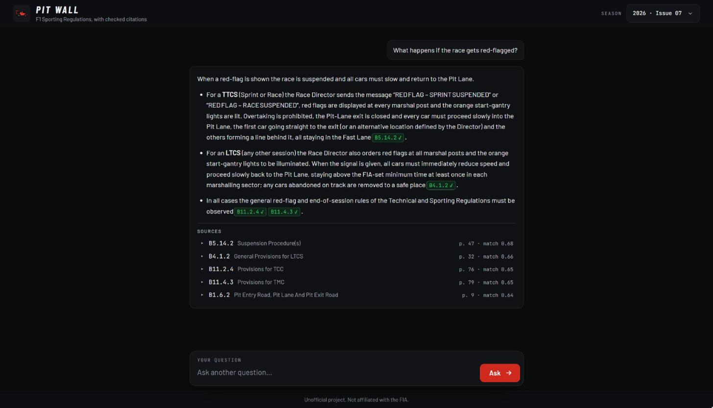
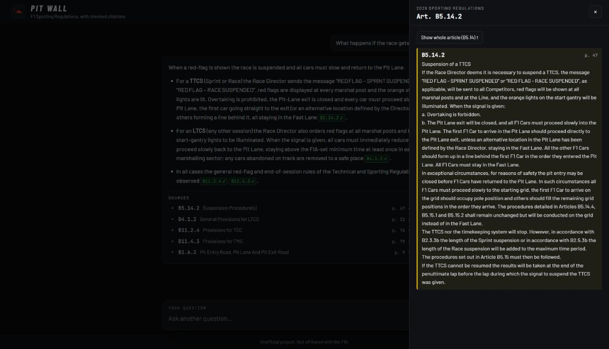
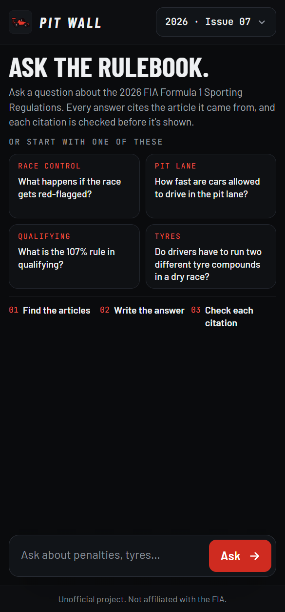
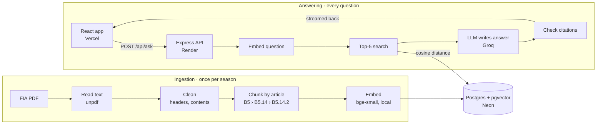

# Pit Wall: F1 Regulations Assistant

Ask questions about the FIA Formula 1 Sporting Regulations and get answers that cite
the exact article they came from (for example `Art. B5.14.2`). Every citation is
checked in code against the articles that were actually retrieved before it's shown.

**Live demo: [pit-wall-rag.vercel.app](https://pit-wall-rag.vercel.app)**. The API runs on a free
server that sleeps when nobody uses it, so the first question can take up to a minute.



## What it does

- **Answers from the rulebook only.** It finds the 5 clauses closest in meaning to your question,
  and the model may only use those. If they don't hold the answer, it says
  "Not found in the regulations."
- **Shows where every claim comes from.** Citations appear as chips. Green ✓ means the code confirmed
  the article was one of those retrieved. A struck-through chip means it wasn't, so don't trust that claim.
- **Lets you check the source.** Click a chip to read the full article, with the cited clause
  highlighted. Each answer also lists the retrieved clauses with their page and match score.
- **Streams the answer** word by word, and works on a phone.

<table>
  <tr>
    <td></td>
    <td></td>
  </tr>
  <tr>
    <td>Clicking a chip opens the full article</td>
    <td>On a phone</td>
  </tr>
</table>

**Built with:** TypeScript · Node 22 + Express 5 · PostgreSQL 17 + pgvector · Drizzle ORM ·
Transformers.js (local embeddings) · Vercel AI SDK + Groq · React 19 + Vite · Vitest.
Hosted for free on Vercel (website), Render (API) and Neon (database).

## Architecture



The embedding model runs inside the API process, so there is no embeddings API to pay for or wait on.
The only external call per question is to the LLM.

## How it works

### Ingestion: from PDF to searchable chunks

1. **Read.** `unpdf` extracts the text page by page, keeping line breaks and page numbers.
2. **Clean.** Contents pages are skipped. Any line that appears on at least half the pages (with
   digits masked, so `56/119` and `57/119` match) is a header or footer and is removed. Broken
   spacing from the PDF (`end -of-session`) is fixed.
3. **Chunk by article.** The FIA numbering (`ARTICLE B5` › `B5.14` › `B5.14.2`, and the 2025 style
   `57)` › `57.2`) is parsed into an article tree. Each clause becomes one chunk. A heading is only
   accepted if it fits in order under its parent and starts with a capital letter, which stops wrapped
   lines like `B5.9 will be followed.` from being read as headings. Clauses over the model's 256-token limit are split at lettered items,
   then at sentences, and keep their ID. The appendix of rules for *future* seasons is skipped.
4. **Embed and store.** Each chunk is embedded together with its heading path
   (`B5.14.2 · TOTAL TIME CLASSIFIED SESSIONS (TTCS) › Suspension Procedure(s)`), so even a one-line
   clause carries its topic. One
   transaction replaces the whole season, so re-running never duplicates anything.

Result for the 2026 regulations (Issue 09, 101 pages): **383 articles, 434 chunks**.

### Answering: from question to checked answer

1. **Retrieve.** The question is embedded and compared with every chunk of the chosen season using
   pgvector's cosine distance. The 5 closest are kept.
2. **Send the sources first.** The browser gets the 5 sources right away, before any answer text.
3. **Generate.** The LLM gets only those 5 chunks, each labelled `[Art. B5.14.2] Title (p. 47)`. The
   rules: answer only from them, cite the labels exactly, and otherwise reply "Not found in the
   regulations." The answer streams to the browser as it's written.
4. **Verify.** When the text is complete, every `[Art. …]` marker is extracted and compared with the
   retrieved IDs. Matches are `verified` and anything else is `rejected`. The UI turns verified ones
   into green chips and strikes out the rest.

Each question is answered on its own, with no chat memory, so every answer stays grounded in the
articles retrieved for it.

## Evaluation

**Retrieval hit rate@5: 26/30 (87%)**: 30 questions, 2026 Sporting Regulations (Issue 09),
measured on 2026-10-25.

- The questions are in [`eval/questions.json`](eval/questions.json). They're written the way a fan would ask,
  not copied from the rulebook, and each lists the article(s) that answer it.
- A question is a **hit** when one of the top 5 chunks is an expected article or sits under one
  (expected `B5.14` matches `B5.14.3`).
- It measures retrieval only and makes no LLM calls, so it's free to re-run:
  `npm run eval:retrieval -- --season 2026` (from `server/`).

The eval decided the embedding model. Both were measured on Issue 07, the issue the app used then:

| Embedding model | Hit rate@5 (Issue 07) |
|---|---|
| `all-MiniLM-L6-v2` (first choice) | 20/30 (67%) |
| `bge-small-en-v1.5` (used now) | **27/30 (90%)** |

Moving to Issue 09 cost one question. Its right answer, B5.13.4 (lapped cars behind the Safety Car), was
4th on Issue 07 and is now just outside the top 5, after small wording changes in the clauses around it.
The four misses: the time limit for a Grand Prix, a car stalling on the grid, practice sessions for rookie
drivers, and when lapped cars may overtake behind the Safety Car.

## Key decisions

| Decision | Why |
|---|---|
| **Chunk by article, one chunk per clause** | The FIA already split the rules into numbered clauses, and a clause is what people cite. Fixed-size chunks would cut a rule in half or glue two together. |
| **Top 5 chunks** | About 1,300 tokens of context, which fits the free LLM tier's per-minute limit. Hit rate@5 shows whether 5 is enough. |
| **Local embedding model, 8-bit** | No API key, cost or rate limit. It's small enough for a 512 MB free server (about 211 MB in use after start-up). |
| **Groq, through the Vercel AI SDK** | A fast free tier, so streaming feels instant. The provider and model are environment variables, and Google Gemini is a one-line switch. |
| **Exact vector search, no index** | With 434 vectors an exact scan takes milliseconds and is 100% accurate. An approximate index like HNSW only pays off past about 100K rows. |
| **Stream first, verify at the end** | Words appear immediately, and the check still runs on the complete answer. Unverified citations are struck out, not hidden. |
| **Drizzle ORM** | Typed queries, schema in TypeScript, generated SQL migrations and built-in pgvector support, while the queries still read like SQL. |
| **Website and API hosted separately** | The free API server sleeps. The static website doesn't, so the page loads instantly and explains the wait while the API wakes up. |
| **No LangChain** | The pipeline is a handful of small steps in `server/src/rag/`. Plain code keeps every step visible and easy to test. |

## Run it locally

You need **Node 22+**, **Docker** and a free **Groq API key** ([console.groq.com/keys](https://console.groq.com/keys)).
The commands below are for bash (macOS, Linux, or Git Bash on Windows).

```bash
git clone https://github.com/samraddh10/pit-wall-rag.git
cd pit-wall-rag

# 1. Start Postgres 17 + pgvector
docker compose up -d --wait

# 2. Install the server and add your settings
cd server
npm ci
cp .env.example .env          # then set GROQ_API_KEY in .env

# 3. Create the tables
npm run db:migrate

# 4. Download the regulations (Issue 09; the PDFs are not in this repo)
curl -L -o ../data/raw/2026.pdf "https://www.fia.com/system/files/documents/fia_2026_f1_regulations_-_section_b_sporting_-_iss_09_-_2026-10-01.pdf"

# 5. Ingest it (the first run also downloads the ~35 MB embedding model)
npm run ingest -- --season 2026

# 6. Start the API on http://localhost:3001
npm run dev
```

Then, in a second terminal:

```bash
cd web
npm ci
npm run dev                   # open http://localhost:5173
```

In development the website forwards `/api` requests to `localhost:3001`, so `web/` needs no settings.

### Other commands (from `server/`)

| Command | What it does |
|---|---|
| `npm run db:check` | Shows that pgvector is installed and how many rows each season has |
| `npm run ingest -- --season 2026 --dry-run` | Runs reading, cleaning and chunking only, and writes each step's output to `data/processed/` |
| `npm run search -- --season 2026 "your question"` | Shows the top 5 chunks, without calling the LLM |
| `npm run ask -- --season 2026 "your question"` | Prints a full answer with verified and rejected citations |
| `npm run eval:retrieval -- --season 2026` | Runs the retrieval evaluation |

## Tests

```bash
cd server
npm test
```

51 unit tests (Vitest). The PDF tests run on short real excerpts of both the 2026 and 2025 rulebooks:

| File | Covers |
|---|---|
| `clean.test.ts` | Contents pages skipped, repeated headers/footers and page labels removed, spacing fixed |
| `chunk.test.ts` | Article IDs, parents, titles and pages for both numbering styles, the in-order rule, long-clause splitting, appendices |
| `citations.test.ts` | Real citations kept, made-up ones rejected, `57.2 a)` shortened to `57.2`, duplicates merged, the "Not found" case |
| `config.test.ts` | Settings: defaults filled in, numbers parsed, empty values ignored, bad values rejected with a readable message |

## Limitations

- **A verified citation is not a verified claim.** The check proves the answer cited an article that was really
  retrieved. It can't prove the sentence matches what that article says. For example, the model once
  expanded "TTCS" wrongly while citing the right article. That's why the sources are always shown.
- **One rulebook, one issue.** It covers the 2026 Sporting Regulations (Section B), Issue 09 of 1 October 2026.
  A new FIA issue has to be downloaded and re-ingested, and other sections (technical, financial) aren't included.
- **The PDF's numbering is kept as printed.** Issue 09 numbers two clauses `B1.5.11` (Rain Hazard, and Normal &
  Low Grip Conditions). The ingest reports it, and both clauses are stored together under `B1.5.11`.
- **Retrieval misses some questions.** 4 of the 30 evaluation questions don't get a correct article in
  the top 5. Since the model may only use those 5, such answers are incomplete or "Not found".
- **No follow-up questions.** Each question is answered on its own.
- **Free-tier limits.** The API sleeps after 15 minutes without visitors and takes up to a minute to wake.
  Each visitor can ask 5 questions a minute, which protects the free LLM quota.
- **Text only.** Tables in the PDF arrive as plain lines of text, which can lose their layout.

## Disclaimer

Unofficial project. Not affiliated with, endorsed by or connected to the FIA or
Formula 1. The regulations are © Fédération Internationale de l'Automobile; the
PDFs are not included in this repository.
